

  <!-- SCREENSHOT: logo or key art, ~600px wide -->
  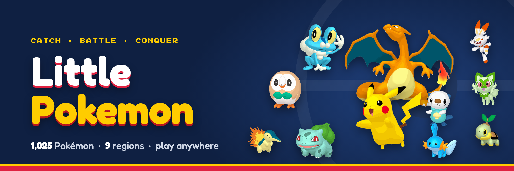

<h1 align="center">Little Pokemon</h1>

  All 1,025 Pokémon. Nine regions. Battles that play by the main-series rules. 
  Play in your browser or on your phone, even without a connection.

  <a href="https://little-pokemon.web.id/play/">Play in browser</a> ·
  <a href="https://github.com/yamaroni/lil-poke/releases">Download for Android / iOS</a>

  <!-- SCREENSHOT: 3 phone captures side by side (home, battle, Pokédex) -->
  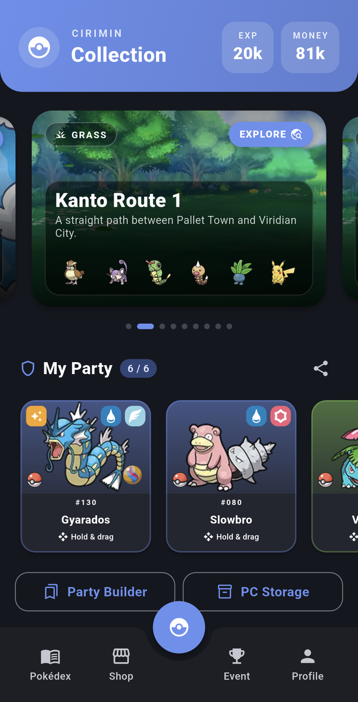
  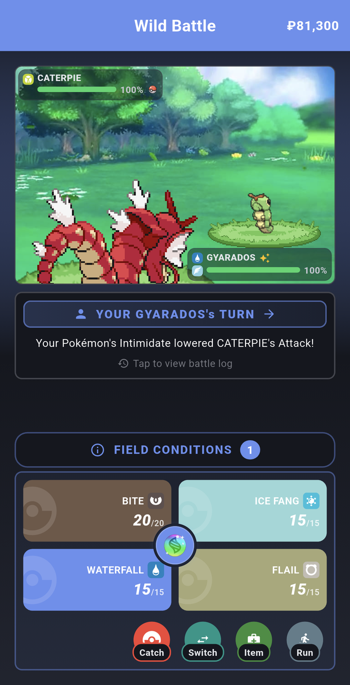
  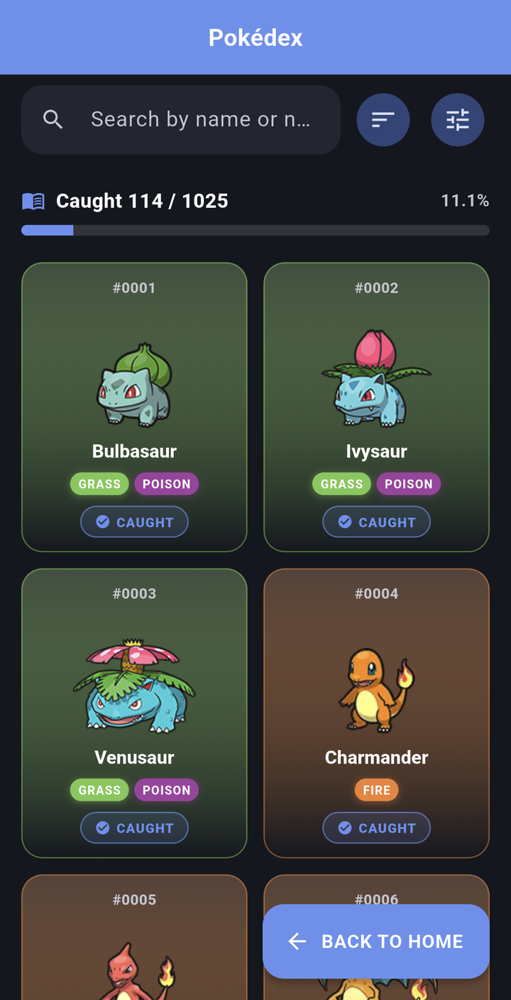

> This game is still in active development. Expect some unfinished features, bugs and occasional breaking changes.

---

## What it is

Little Pokemon is a fan-made collect-and-battle game. You pick a starter, walk a region's routes, catch what you find, and fight your way through trainers, Gym Leaders and the Elite Four. When you've beaten a region, you move on to the next one and start a new team there.

There's no overworld to walk around. Each region is a set of locations you swipe through, and every encounter, trainer and gym opens straight into a turn-based battle. A session can be five minutes or two hours.

Once it's loaded, the game plays offline, so it works on a plane or a train.

## Nine regions, each with its own gimmick

Kanto, Johto, Hoenn, Sinnoh, Unova, Kalos, Alola, Galar and Paldea are all playable, with their own wild encounter tables, route trainers, gyms, Elite Four and legendaries. Each region keeps its own party, storage and EXP, so every region is a fresh run.

| Region | What's different |
|---|---|
| Kanto → Kalos | The classic gym path: 8 badges each, 10 in Unova |
| Alola | No gyms. You clear Island Trials against Totem Pokémon, and a cleared trial unlocks Z-Moves |
| Galar | Max Raid Dens with Gigantamax bosses. Dynamax costs Wishing Pieces you earn in those dens |
| Paldea | 18 badges split across Gyms, Team Star and the Titans. Tera Raid crystals pay out Tera Shards for Terastallization |

  <!-- SCREENSHOT: region carousel / location card -->
  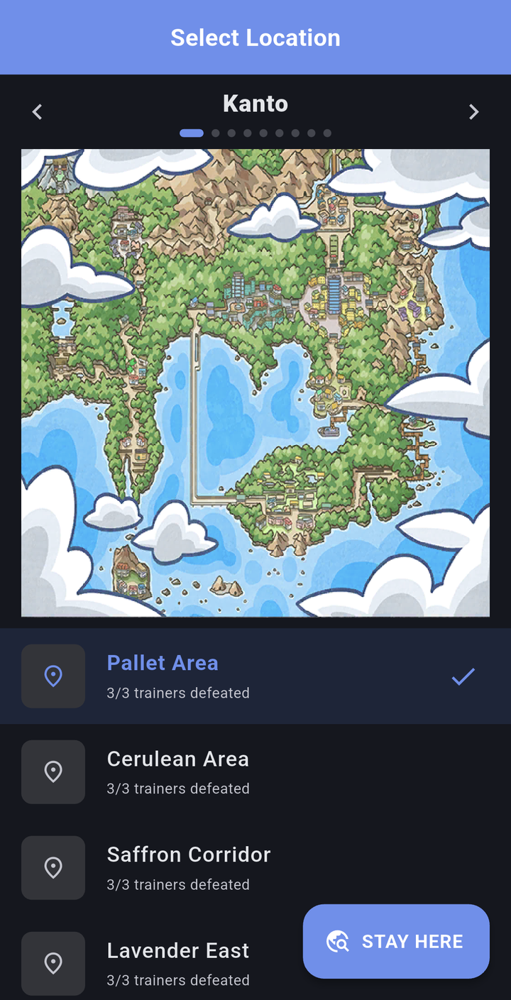
  <!-- SCREENSHOT: Alola Island Trial list or Totem battle -->
  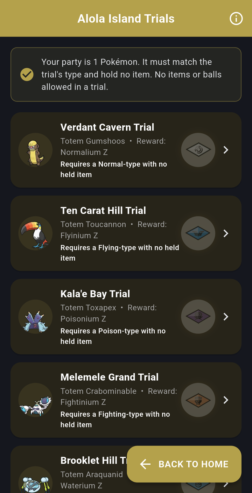
  <!-- SCREENSHOT: Galar raid den board -->
  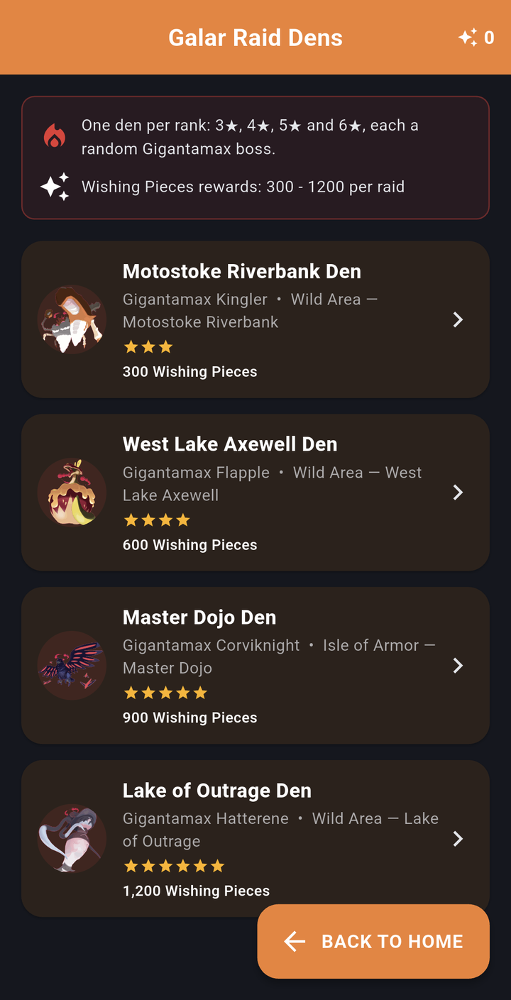

## Battles that follow the real rules

If you know how a move or ability works in the main games, it works the same way here. Type matchups, weather, terrain, status, stat boosts, critical hits and who moves first all behave the way you'd expect, so the strategies you already know still pay off.

Every Pokémon battles at level 50, and you get:

- Around 830 moves and 370 abilities, including the signature moves of alternate forms
- Around 340 held items, from Leftovers and Choice Scarf to plates, memories and masks that change a Pokémon's form
- Mega Evolution, Primal Reversion, Ultra Burst, Z-Moves, Dynamax, Gigantamax and Terastallization
- Double battles against trainers who use them, with spread moves, redirection, ally abilities and Pledge combos

  <!-- SCREENSHOT: singles battle mid-turn with move picker open -->
  
  <!-- SCREENSHOT: Mega Gyarados in a trainer battle (swap for a GIF later if you record one) -->
  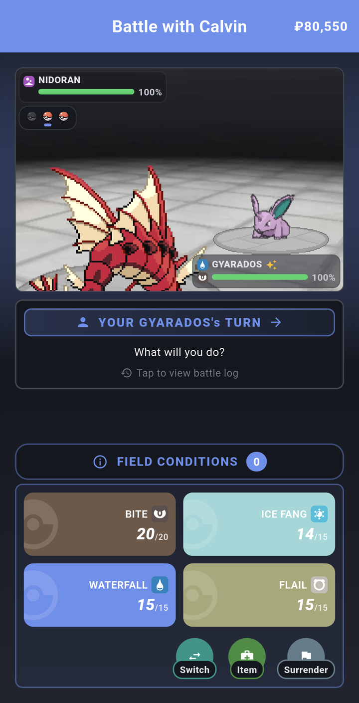
  <!-- SCREENSHOT: double battle -->
  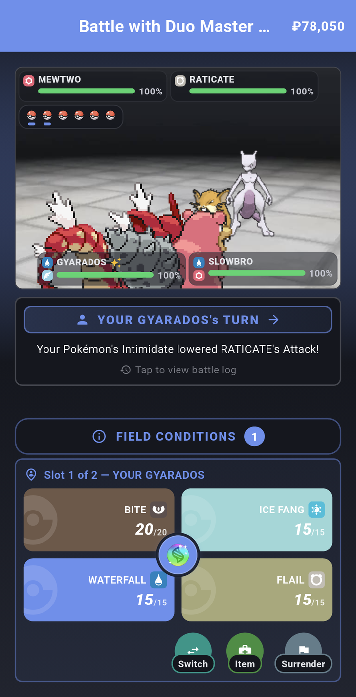

## Build the team you want

Catching is only the start. Spend EXP and money to shape each Pokémon:

- Teach moves from its level-up, egg and TM pools
- Swap its ability or nature
- Set EVs by hand, up to 252 in a stat and 510 in total
- Evolve it, or change it into an alternate form (Rotom, Therian forms, regional variants, Kyurem fusions)
- Rename it and pick the Poké Ball it sits in
- Save party presets per region and switch teams in one tap

  <!-- SCREENSHOT: Pokémon detail sheet -->
  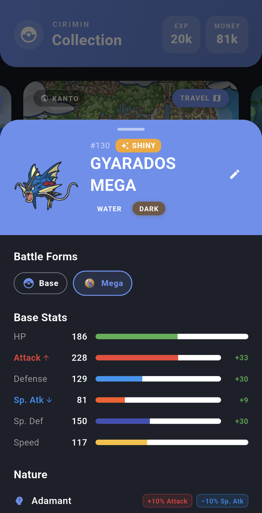
  <!-- SCREENSHOT: change moves / EV screen -->
  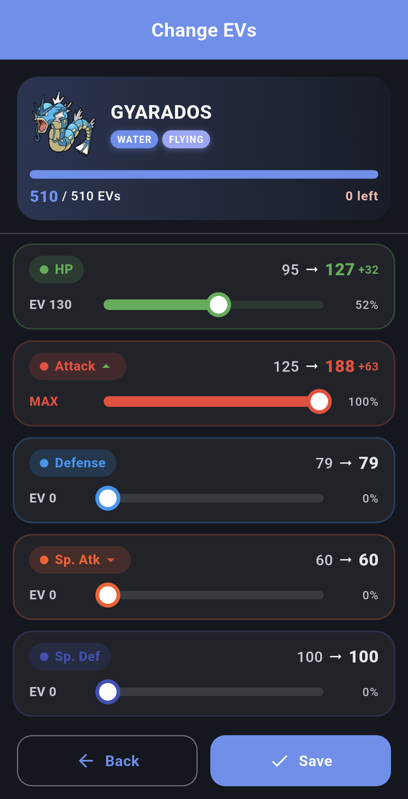
  <!-- SCREENSHOT: party builder -->
  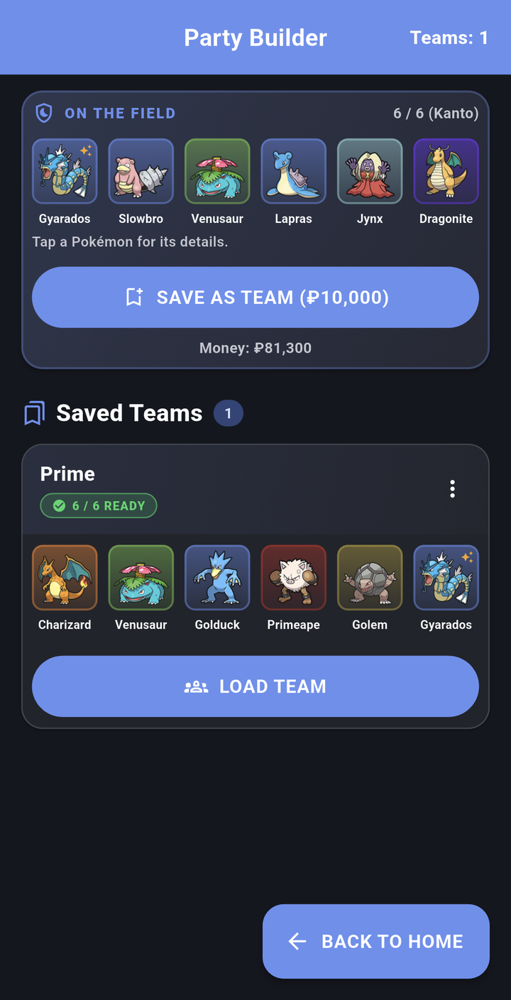

## Things to chase

- Shinies. Wild Pokémon roll shiny at 1 in 128, legendaries at 1 in 256. Shiny Incense improves the odds.
- Legendaries and Ultra Beasts. They unlock once you clear a region, and each one carries a fixed, curated moveset.
- The national Pokédex. It counts the pre-evolutions of everything you own, and marks a region complete when you've caught its whole dex.
- 85 achievements, from your first catch to lifetime money spent.
- The Hall of Fame, which records the party that beat each region's Champion.

Along the way, Team Rocket may ambush you and grab half your party. You win them back in battle, or you pay for losing.

  <!-- SCREENSHOT: Pokédex grid with caught + silhouettes -->
  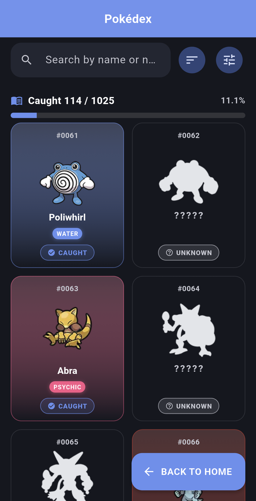
  <!-- SCREENSHOT: legendary list -->
  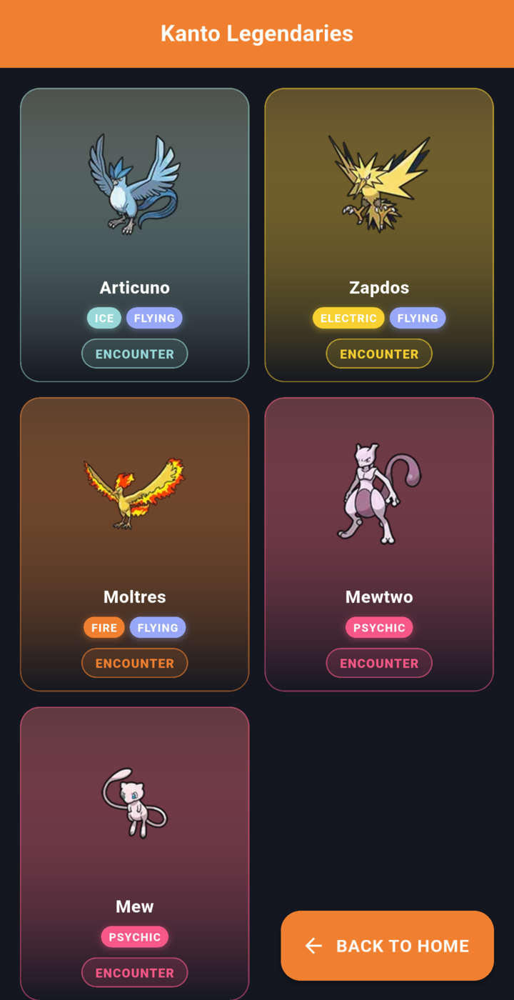
  <!-- SCREENSHOT: profile with Hall of Fame + achievements -->
  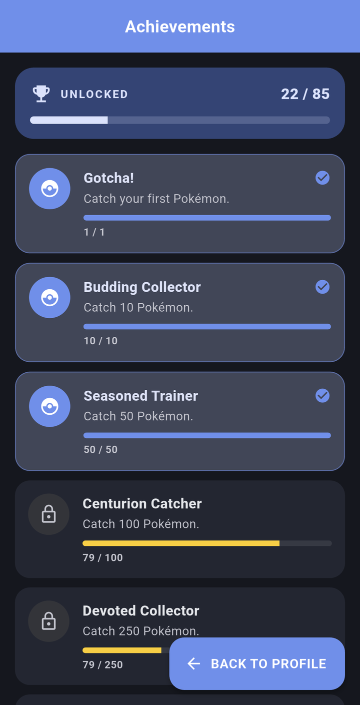

## Your save stays yours

There's no account to make and nothing to sign into. Your progress stays on your device. Want to switch phones? Export your save from the Profile screen and import it on the new one. The game keeps a backup from before each import, so you can undo it.

## Play

| Platform | How |
|---|---|
| Browser | [little-pokemon.web.id/play](https://little-pokemon.web.id/play/). Works on desktop and mobile browsers |
| Android / iOS | Builds on the [releases page](https://github.com/yamaroni/lil-poke/releases) |

The first visit in a browser takes a moment to load. After that, it starts fast.

<!-- OPTIONAL: gameplay trailer. GitHub renders an uploaded .mp4 dragged into the README editor. -->
<!-- VIDEO: https://github.com/user-attachments/assets/<your-upload-id> -->

## Support the game

Little Pokemon is free, and it will stay that way. There are no ads and nothing to buy inside the game. If you've had fun with it and want to see more regions, trainers and moves added, you can chip in. Donations pay for development time, artwork and testing.

  
  
  

Playing from Indonesia? Saweria lets you send support with local e-wallets or QRIS.

No spare cash? Sharing the game with a friend or a Pokémon group helps just as much.

## Hall of Fame supporters

These trainers backed the game before most people had heard of it. Thank you.

- Noris Qironik ([Facebook](https://www.facebook.com/norizt.arianis/))
- Erick Javier ([Facebook](https://www.facebook.com/erick.aliaga1/))
- Lloyd Vincent Soliven ([Facebook](https://www.facebook.com/EtheriousSunJin/))
- Remigiusz Barankiewicz ([Facebook](https://www.facebook.com/remigiusz.barankiewicz))
- Hunter Nunn ([Facebook](https://www.facebook.com/hunter.nunn.383942))
- Andrew Smith ([Facebook](https://www.facebook.com/andrew.smith.705413/))
- 1 anonymous trainer

Supported the game and want your name here? Tell me how you'd like to be credited, or ask to stay anonymous.

## Report a bug or suggest something

Found a bug, a move that doesn't work the way it does in the main games, or a region that feels too easy or too hard? [Open an issue](https://github.com/yamaroni/little-pokemon/issues). Include the Pokémon, the move or screen, and what you expected to happen. Ideas for new features are welcome there too.

---

Little Pokemon is a non-commercial fan project. It is not affiliated with, endorsed by, or sponsored by Nintendo, Game Freak, Creatures Inc. or The Pokémon Company. Pokémon and all related names, characters and images are trademarks of their respective owners. The game is free and has no ads or in-app purchases.

